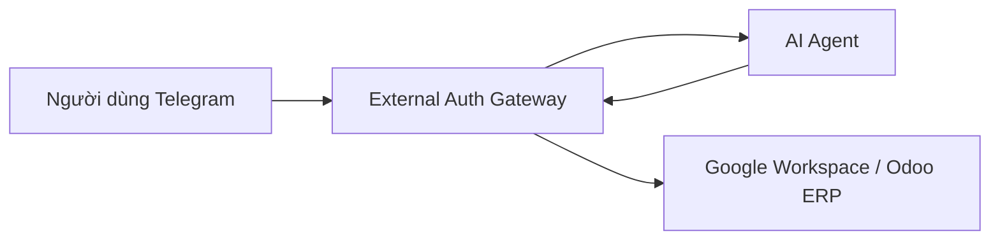

# Enterprise AI Agent — Trợ Lý Doanh Nghiệp Tích Hợp

> Hệ thống Trợ lý AI điều hành và tự động hóa tác vụ văn phòng, phục vụ cán bộ nhân viên thông qua giao diện trò chuyện Telegram kết nối an toàn với Google Workspace và hệ sinh thái Odoo ERP.

---

### 📌 Lộ Trình Đọc Tài Liệu

Tùy theo nhu cầu và vai trò của bạn, vui lòng chọn tài liệu phù hợp:

- 👔 **[Tổng quan dành cho quản lý (docs/PROJECT_OVERVIEW.md)](docs/PROJECT_OVERVIEW.md)**: Dành cho Ban Quản lý, Giám đốc và Trưởng bộ phận — Giải thích bài toán doanh nghiệp, giá trị mang lại, bảng hiện trạng chức năng (đã triển khai, đã kiểm chứng, đang phát triển) và các bước tiếp theo (thời gian đọc ~5 phút).
- 💻 **[Hướng dẫn dành cho lập trình viên (docs/DEVELOPER_GUIDE.md)](docs/DEVELOPER_GUIDE.md)**: Dành cho kỹ sư backend và intern — Hướng dẫn cài đặt Python 3.11, thiết lập môi trường, chạy test suite, cấu trúc thư mục, luồng xử lý `/today` và quy trình đóng góp mã nguồn (TDD).
- 🔌 **[Đặc tả tích hợp Auth Gateway (docs/INTEGRATION_GATEWAY.md)](docs/INTEGRATION_GATEWAY.md)**: Chi tiết hợp đồng API nội bộ, cơ chế hàng đợi Telegram, chống gửi trùng và bảo mật service secret.

---

## 1. Mục Đích Dự Án & Ví Dụ Công Việc Cụ Thể

Hệ thống được xây dựng nhằm giải quyết bài toán phân mảnh thông tin trong doanh nghiệp. Thay vì nhân viên phải mở nhiều ứng dụng độc lập trên điện thoại để kiểm tra lịch họp, đọc email hay theo dõi công việc cá nhân, AI Agent cung cấp một điểm tiếp nhận tập trung ngay trên Telegram.

**Ví dụ công việc cụ thể:**
Vào đầu ngày làm việc (8:00 sáng), nhân viên mở Telegram nhắn `/today` hoặc *"Hôm nay tôi có gì?"*. Hệ thống lập tức nhận diện nhân sự và phản hồi bản tin tổng hợp gồm:
1. **Lịch làm việc hôm nay:** Danh sách các cuộc họp từ Google Calendar kèm giờ bắt đầu, kết thúc và link cuộc họp.
2. **Hộp thư Gmail:** Số lượng thư chưa đọc trong hòm thư công ty và danh sách các thư quan trọng mới nhất.
3. **Công việc cá nhân:** Các đầu việc cần hoàn thành đến hạn hôm nay và danh sách việc quá hạn từ kho dữ liệu cá nhân.

Toàn bộ thông tin được tổng hợp từ dữ liệu thật trong vòng vài giây, giúp nhân viên chủ động sắp xếp ngày làm việc hiệu quả.

---

## 2. Kiến Trúc Tích Hợp & Phân Định Trách Nhiệm

Hệ thống vận hành theo mô hình kiến trúc phân tách ranh giới an toàn giữa cổng xác thực ngoại vi (**External Auth Gateway**) và dịch vụ xử lý nghiệp vụ thông minh (**AI Agent**):



### Phân công trách nhiệm rõ ràng:
- **External Auth Gateway (`auth-gateway`):**
  - Đóng vai trò là chốt chặn an toàn ngoại vi: duy nhất Gateway kết nối với Telegram Bot API và tiếp nhận tin nhắn người dùng.
  - Quản trị toàn bộ thông tin đăng nhập, token OAuth của Google Workspace (Calendar, Gmail) và Odoo ERP.
  - Quản lý hàng đợi bền vững chống mất mát dữ liệu và ngăn chặn gửi trùng tin nhắn khi có sự cố mạng.
  - Cung cấp cổng thông tin (Portal) để nhân viên tự đăng nhập và liên kết tài khoản.
- **AI Agent (`AI-Agent`):**
  - Đóng vai trò là bộ não xử lý nghiệp vụ: nhận yêu cầu đã được Gateway xác thực danh tính qua kênh nội bộ có bảo vệ bằng service secret.
  - Phân tích ý định người dùng (Intent Dispatcher) và điều phối tổng hợp dữ liệu.
  - Quản lý kho công việc cá nhân được cách ly nghiêm ngặt theo mã định danh nhân sự (`owner_key`).
  - Tuyệt đối không lưu trữ credential hay OAuth refresh token của người dùng.

---

## 3. Phân Biệt Các Chế Độ Hoạt Động & Tính Năng

Hệ thống hỗ trợ 2 chế độ vận hành (cấu hình qua biến môi trường `INTEGRATION_MODE`):

### Chế độ Gateway (`INTEGRATION_MODE=gateway`) — *Trọng tâm hiện tại*
Đây là chế độ vận hành tiêu chuẩn phối hợp cùng Auth Gateway. Các tính năng đang được mở bao gồm:
- **Bản tin buổi sáng (`/today`):** Tổng hợp lịch Google Calendar, thư Gmail chưa đọc và công việc cá nhân từ 100% dữ liệu thực tế.
- **Tra cứu hồ sơ định danh:** Kiểm tra tài khoản Odoo, phòng ban và quyền hạn của nhân sự.
- **Kiểm tra trạng thái kết nối:** Tra cứu tình trạng liên kết Odoo và quyền Google Workspace.
- **Tra cứu công việc cá nhân:** Liệt kê việc quá hạn và việc cần làm hôm nay, cách ly tuyệt đối giữa các nhân viên.
- **Từ chối an toàn:** Các câu hỏi nằm ngoài phạm vi hỗ trợ sẽ được thông báo lịch sự, không tự suy đoán thông tin ngoài thẩm quyền.

### Chế độ Trực tiếp (`INTEGRATION_MODE=direct`) & Tính năng đang phát triển
- **Chế độ Direct (Cục bộ):** Kế thừa từ giai đoạn phát triển ban đầu phục vụ kiểm thử nội bộ module AI. Hỗ trợ kết nối trực tiếp Odoo qua XML-RPC, LangGraph orchestration và các kỹ năng xử lý tài liệu cục bộ (PDF, Excel, ghi chú).
- **Tính năng đang phát triển:** Các thao tác ghi dữ liệu (tạo cuộc họp, gửi email, cập nhật đơn hàng Odoo) qua bot Telegram sẽ được triển khai trong giai đoạn tiếp theo sau khi hoàn thiện cơ chế xác nhận người dùng 2 bước (Human-in-the-loop).

---

## 4. Bắt Đầu Nhanh Dành Cho Lập Trình Viên

1. **Khởi tạo môi trường ảo Python 3.11:**
   ```powershell
   py -3.11 -m venv .venv
   .\.venv\Scripts\Activate.ps1
   pip install -r requirements.txt
   ```
2. **Kiểm tra bộ kiểm thử tự động:**
   ```powershell
   python -m pytest -q
   ```
   *(Toàn bộ 169 kiểm thử tự động phải vượt qua mà không có lỗi).*
3. **Cấu hình môi trường:**
   Sao chép `.env.example` thành `.env` và điền các khóa bí mật nội bộ theo hướng dẫn tại [DEVELOPER_GUIDE.md](docs/DEVELOPER_GUIDE.md).

---

## 5. Danh Mục Tài Liệu Tham Khảo

- 📄 [Tổng quan dự án dành cho quản lý](docs/PROJECT_OVERVIEW.md)
- 📄 [Hướng dẫn phát triển dành cho lập trình viên](docs/DEVELOPER_GUIDE.md)
- 📄 [Đặc tả kỹ thuật tích hợp Gateway](docs/INTEGRATION_GATEWAY.md)
- 🗄️ [Lưu trữ báo cáo tiến độ lịch sử](docs/reports/)
  - [Báo cáo công việc tuần 1](docs/reports/WEEKLY_REPORT.md)
  - [Báo cáo tổng kết tuần 2](docs/reports/WEEKLY_DEVELOPMENT_REPORT.md)
