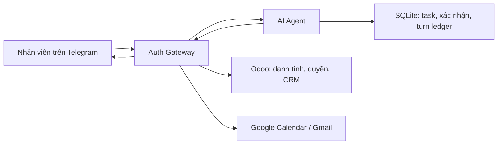
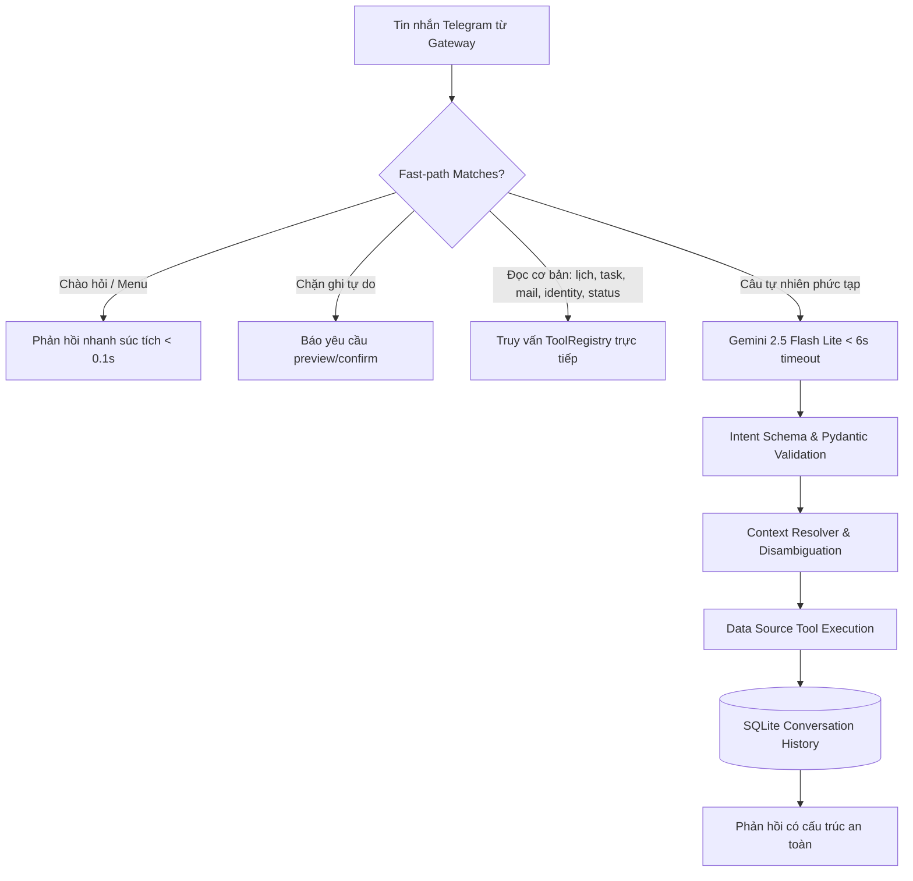

# AI Agent — Trợ lý công việc qua Telegram

Dịch vụ Python/FastAPI xử lý yêu cầu công việc từ Telegram qua Auth Gateway: tổng hợp điểm tin, đọc lịch/email/CRM, quản lý công việc cá nhân và chuẩn bị thao tác ghi để người dùng xác nhận.

README này hướng dẫn riêng dự án agent. Có thể cài dependencies và chạy unit test bằng repository này; không cần mã nguồn của dịch vụ bên ngoài. Khi chạy tích hợp, cần URL và secret của dịch vụ xác thực/API được cấp.

> **Trạng thái:** đang phát triển. Một số luồng ghi và xử lý retry còn lỗi đã biết; chưa nghiệm thu toàn bộ bằng tài khoản thật. Xem phần giới hạn cuối README.

## Kiến trúc



Agent chịu trách nhiệm phân tích yêu cầu, tạo phản hồi, quản lý task cá nhân, bản xem trước và xác nhận. Trong gateway mode, danh tính/quyền và dữ liệu Odoo/Google được lấy qua API bên ngoài; việc nhận/gửi Telegram do bên gọi endpoint turn đảm nhiệm.

Luồng chính là `gateway`. Repo còn có `direct` với connector, skill và LangGraph; đó là luồng riêng. Trong gateway mode, không chạy `start_bot.bat` hoặc poller Telegram của agent.

## Kiến trúc Pipeline Ngôn ngữ Tự nhiên & Hiệu năng cao

Hệ thống AI Agent hiện tại áp dụng kiến trúc pipeline đa tầng kết hợp xử lý nhanh (fast-path deterministic routing) và trí tuệ nhân tạo (Gemini LLM):



### Kết quả đo lường độ trễ & độ chính xác (Benchmark 2026-10-27)

Hệ thống cung cấp công cụ kiểm chuẩn độc lập `scripts/benchmark_latency.py` với hai chế độ đo lường minh bạch:

#### 1. Benchmark Router / Pipeline phân tích ý định (`--mode router`)
*Phạm vi: Đo tốc độ phân loại ý định, trích xuất tham số trong bộ nhớ (offline logic).*

| Nhóm yêu cầu | Số mẫu | Độ chính xác | p50 | p95 | Max |
|---|---|---|---|---|---|
| **Greeting / Menu** | 60 | 100.0% | 0.014 ms | 0.079 ms | 0.111 ms |
| **Task with greeting** | 15 | 100.0% | 0.013 ms | 0.026 ms | 0.026 ms |
| **Read Data (Lịch, Task, Mail, CRM)** | 90 | 100.0% | 0.011 ms | 0.023 ms | 5.052 ms |
| **Draft & Write (Bản nháp & Soạn gửi)** | 30 | 100.0% | 0.015 ms | 0.024 ms | 0.125 ms |
| **Confirm / Status (/confirm, /status)** | 30 | 100.0% | 0.004 ms | 0.007 ms | 0.016 ms |

#### 2. Benchmark Toàn trình Endpoint Turn (`--mode endpoint`)
*Phạm vi: Toàn trình API `/internal/v1/telegram/turn` bao gồm xác thực định danh Identity, Turn sequential lease, Pipeline, UnifiedExecutor, lưu trữ SQLite và kết xuất phản hồi (ranh giới HTTP/SDK giả lập).*

| Hạng mục Turn | Số mẫu | p50 | p90 | p95 | Min | Max |
|---|---|---|---|---|---|---|
| **Greeting** | 15 | 40.25 ms | 52.83 ms | 71.96 ms | 36.39 ms | 71.96 ms |
| **Capability (/help)** | 15 | 36.19 ms | 47.00 ms | 47.15 ms | 34.34 ms | 47.15 ms |
| **Identity (Whoami)** | 15 | 32.93 ms | 34.58 ms | 39.34 ms | 31.24 ms | 39.34 ms |
| **Briefing (/today)** | 15 | 32.55 ms | 39.46 ms | 46.00 ms | 29.40 ms | 46.00 ms |
| **Tasks List** | 15 | 38.10 ms | 42.26 ms | 44.78 ms | 33.55 ms | 44.78 ms |
| **Calendar List** | 15 | 38.67 ms | 44.41 ms | 44.82 ms | 34.42 ms | 44.82 ms |
| **Task Create Preview** | 15 | 35.56 ms | 39.44 ms | 43.16 ms | 33.25 ms | 43.16 ms |

* Tỷ lệ hoàn tất turn thành công: **100.0% (105/105 lượt)**, không có request bị kẹt lease hay timeout.
* **Lưu ý nghiệp vụ:** Các chỉ số trên đo đạc chi phí tính toán và điều phối nội bộ của Agent. Trong môi trường production thực tế, tổng thời gian người dùng chờ phản hồi sẽ bao gồm thêm độ trễ mạng mạng Telegram Bot API và thời gian phản hồi của mô hình LLM (nếu câu phức tạp kích hoạt Gemini Flash Lite, giới hạn deadline 6s).

## Phạm vi tính năng hiện có

| Nhóm | Khả năng có trong mã |
|---|---|
| Hồ sơ | Tên, Odoo UID, tenant/database, chức vụ, phòng ban và quyền do gateway cung cấp |
| Kết nối | Trạng thái Odoo, Telegram, Google và OAuth scopes |
| Điểm tin | `/today` hoặc hỏi *"Hôm nay tôi có gì?"*: lịch trong ngày, việc cần xử lý, Gmail chưa đọc |
| Công việc cá nhân | Xem, tạo, sửa tiêu đề, hoàn thành; phân tách theo owner key |
| Calendar | Xem lịch, tạo sự kiện mới, cập nhật lịch qua preview và xác nhận (hỗ trợ ETag / If-Match) |
| Gmail | Đọc thư chưa đọc, chuẩn bị và gửi email sau xác nhận |
| CRM | Tra cứu, tạo/sửa cơ hội qua preview và xác nhận (hỗ trợ expected_write_date); hiển thị chính xác mã lead |
| Ngôn ngữ tự nhiên | NaturalPipeline kết hợp ToolRegistry, IntentSchema, ContextResolver (xử lý thời gian tương đối, tham chiếu danh sách gần nhất) |

Thao tác ghi đi qua preview và xác nhận có hạn 5 phút, gắn với người dùng, private chat và Telegram binding. Chưa mở xóa dữ liệu, gửi thư hàng loạt, HR/kế toán hoặc tệp đính kèm qua luồng này.

Chức vụ dùng cho ngữ cảnh/cá nhân hóa, không tự cấp quyền. Tài khoản Google có thể là Gmail cá nhân nếu gateway cho phép; lịch và thư thuộc tài khoản Google đã liên kết, quyền CRM vẫn thuộc Odoo.

## Cài đặt

Yêu cầu Python 3.11. Chạy từ thư mục chứa `requirements.txt` trên PowerShell:

```powershell
py -3.11 -m venv .venv
.\.venv\Scripts\python.exe -m pip install -r requirements.txt
.\.venv\Scripts\python.exe -m pytest tests/unit tests/integration/test_internal_turn.py -q
```

Nhóm test này dùng dữ liệu tạm và mock; không cần gateway, Telegram token, LLM key, PostgreSQL hoặc Redis thật. Các module ngoài nhóm test này có thể có yêu cầu riêng.

## Cấu hình gateway mode

```powershell
# Bỏ qua nếu đã có .env, tránh ghi đè cấu hình hiện tại.
Copy-Item .env.example .env
```

Thiết lập tối thiểu:

```dotenv
APP_ENV=development
APP_DEBUG=false
PORT=8000
INTEGRATION_MODE=gateway
GATEWAY_BASE_URL=http://localhost:8080
GATEWAY_TO_AGENT_SECRET=<secret-chieu-gateway-den-agent>
AGENT_TO_GATEWAY_SECRET=<secret-chieu-agent-den-gateway>
# Để trống nếu chỉ thử lệnh xác định, không dùng Gemini parser.
GEMINI_API_KEY=
```

Hai secret phải khác nhau, mỗi secret ít nhất 32 ký tự và khớp với gateway. Sinh secret bằng:

```powershell
.\.venv\Scripts\python.exe -c "import secrets; print(secrets.token_urlsafe(48)); print(secrets.token_urlsafe(48))"
```

Thay các giá trị mẫu trước khi dùng. Khi bật phân tích ngôn ngữ tự nhiên, đặt `GEMINI_API_KEY` và `DEFAULT_LLM_MODEL` phù hợp với môi trường được cấp. Parser gateway hiện dùng Gemini; chỉ điền `OPENAI_API_KEY` chưa thay thế được parser này.

Credential Odoo, bot token Telegram và OAuth Google của người dùng được cấu hình/quản lý tại gateway. Những biến tương ứng trong file mẫu agent chủ yếu phục vụ direct mode; không sao chép credential người dùng sang agent để khắc phục lỗi tích hợp.

Yêu cầu đối với dịch vụ bên ngoài: cung cấp identity contract v2, API dữ liệu/action và chuyển yêu cầu tới endpoint turn của agent. Thống nhất URL cùng hai secret với người vận hành dịch vụ đó; không cần cấu hình hoặc clone mã nguồn dịch vụ trong repository này.

`.env.example` không tự cập nhật `.env` đang dùng; code agent mặc định `direct` nếu không đặt mode.

## Khởi động

```powershell
.\.venv\Scripts\python.exe -m uvicorn app.main:app --host 127.0.0.1 --port 8000
```

- Healthcheck: [http://localhost:8000/api/v1/health](http://localhost:8000/api/v1/health).
- OpenAPI: [http://localhost:8000/docs](http://localhost:8000/docs), chỉ khi đặt `APP_DEBUG=true`.

Nhân viên đăng nhập và liên kết tài khoản tại portal gateway trước khi gửi yêu cầu tới bot. Agent tra identity qua gateway; người dùng không cần đăng nhập Odoo lần hai trong luồng này.

API khởi động thành công không chứng minh Odoo/Google đã kết nối. Healthcheck không thay thế kiểm tra quyền và dữ liệu thật.

## Ví dụ sử dụng

| Yêu cầu trên Telegram | Mục đích |
|---|---|
| `/today` | Điểm tin hôm nay |
| `Tôi là ai?` | Hồ sơ đã xác minh |
| `Kiểm tra kết nối` | Trạng thái các dịch vụ |
| `/task list` | Danh sách công việc cá nhân |
| `/task create Báo cáo tuần` | Preview tạo công việc |
| `/task done task_12345678` | Preview hoàn thành công việc |
| `/calendar list` | Lịch sắp tới |
| `/email list` | Gmail chưa đọc |
| `/crm search khách hàng` | Tra cứu lead |
| `/confirm <mã>` hoặc `/cancel <mã>` | Thực thi hoặc hủy yêu cầu đang chờ |

Ví dụ cú pháp đầy đủ để tạo preview, dùng dữ liệu thử nghiệm:

```text
/task create Báo cáo tuần | 2026-11-01T17:00:00+07:00 | high
/calendar create Họp nhóm | 2026-11-01T09:00:00+07:00 | 2026-11-01T10:00:00+07:00
/email send colleague@example.com | Tiêu đề thử nghiệm | Nội dung thử nghiệm
/crm create Cơ hội thử nghiệm | 0900000000 | customer@example.com | 1000000
```

ID và mã xác nhận phải lấy từ phản hồi thật. Kiểm tra preview trước khi xác nhận; không tự gửi lại thao tác ghi khi kết quả trước đó chưa xác định.

## API và đường xử lý

Gateway gọi `POST /internal/v1/telegram/turn` với `Authorization: Bearer <GATEWAY_TO_AGENT_SECRET>`. Agent trả `request_id` và danh sách chuỗi `messages`; gateway giao lên Telegram.

Agent dùng `AGENT_TO_GATEWAY_SECRET` để gọi identity, connections, Calendar/Gmail/CRM và API actions. Identity yêu cầu contract v2. HTTP 200 có thể chứa thông báo lỗi quyền/kết nối hoặc yêu cầu xác nhận; không phải bằng chứng nghiệp vụ thành công.

| Thành phần | Vị trí |
|---|---|
| Endpoint turn | `app/api/v1/internal.py` |
| Dispatcher và Gemini parser | `app/services/gateway_agent_dispatcher.py` |
| HTTP client gateway | `app/services/gateway_client.py` |
| Xác nhận và sổ turn | `app/services/confirmation_service.py`, `app/services/turn_ledger.py` |
| Task cá nhân | `app/providers/tasks/local.py` |
| Điểm tin | `app/services/morning_briefing_service.py` |

Thêm skill vào registry direct mode không tự mở skill đó qua gateway.

## Lưu trữ và Docker

Task và xác nhận nằm trong `data/tasks.db`; sổ turn nằm trong `data/turn_ledger.db`, tính từ thư mục chạy. Các module khác còn có dữ liệu runtime riêng. Không commit `.env`, `data/`, `.agent_data/`, token hoặc bản sao lưu.

Compose hiện gồm agent, PostgreSQL và Redis; agent nối thêm mạng ngoài `auth_gateway_net`. Mạng này phải tồn tại trước khi khởi động. Khi chạy độc lập, tạo mạng nếu chưa có:

```powershell
docker network create auth_gateway_net
docker compose up -d --build
docker compose logs -f ai-agent
```

Đặt `GATEWAY_BASE_URL` theo địa chỉ dịch vụ API bên ngoài mà container truy cập được. Nếu dịch vụ nằm trên mạng chung, dùng tên service/alias và cổng nội bộ được cung cấp. Không dùng `localhost` để gọi container khác.

Compose đã được cấu hình gắn volume bền vững `agent_sqlite_data` cho thư mục `/app/data` của agent (lưu trữ `tasks.db`, `turn_ledger.db`, `reminders.db`...) và kết nối mạng chung `auth_gateway_net`. Dữ liệu nghiệp vụ và trạng thái idempotency được bảo toàn qua các lần tạo lại container.

## Kiểm thử và kết quả xác minh

```powershell
# Chạy toàn bộ test suite của Agent trong môi trường cô lập (391 passed, 1 skipped, 0 failed):
.\.venv\Scripts\python.exe -B -X utf8 -m pytest -q --disable-warnings --tb=short

# (Tùy chọn) Chạy riêng integration test kiểm tra endpoint turn nội bộ:
.\.venv\Scripts\python.exe -m pytest tests/integration/test_internal_turn.py -v
```

### Kết quả xác minh và phạm vi đã kiểm chứng

- **391 test đạt, 1 test skipped**: Bao gồm unit test cho identity context contract v2, dispatcher định tuyến lệnh/preview, xác thực token xác nhận nguyên tử, turn ledger idempotency, bộ định dạng kết quả, NaturalPipeline, 98 ca hội thoại tự nhiên, và các bộ test hồi quy khắt khe cho execution hardening, task revision conflict, email draft CAS và lease recovery.
- **Giải thích test bị bỏ qua (1 skipped)**: Test `tests/test_security.py::test_traversal_via_symlink` bị bỏ qua có chủ đích khi chạy trên môi trường Windows không bật quyền Administrator hoặc Developer Mode (`pytest.skip("Cannot create symlinks on this Windows setup")`). Đây là cơ chế bảo vệ tiêu chuẩn khi hệ điều hành hạn chế quyền tạo symbolic link, không ảnh hưởng đến logic nghiệp vụ hay an toàn của ứng dụng.
- **Git diff**: Kiểm tra `git diff --check` đạt chuẩn, không có lỗi khoảng trắng hay định dạng thừa.

> **Lưu ý quan trọng về phạm vi kiểm thử:**
> Bộ 391 test tự động được thực hiện trong môi trường kiểm thử cô lập (giả lập Gateway response, SQLite tạm thời, không gọi ra API bên ngoài hoặc LLM thật). Kiểm thử tự động chứng minh sự ổn định của contract API, logic nghiệp vụ nội bộ và cơ chế bảo vệ dữ liệu, nhưng **không thay thế việc nghiệm thu thực tế bằng tài khoản thật**. Người dùng cần chạy thử nghiệm trên bot Telegram thật kết nối với Gateway theo checklist dưới đây.

### Trạng thái các cải tiến cốt lõi đã hoàn tất

1. **API đọc chi tiết Calendar/CRM:** Gateway đã sửa đúng chữ ký giải mã credential và kiểm tra quyền, cho phép Agent lấy snapshot và ETag/write_date thật để thực hiện preview/update an toàn.
2. **Xác minh trước khi đọc cache turn:** Agent resolve identity từ Gateway trước khi truy xuất cache hoặc nhận turn. Đối chiếu `telegram_binding_id`, từ chối replay các bản ghi cũ thiếu binding/hash, và trả HTTP 503 khi gặp sự cố mạng Gateway tạm thời.
3. **Thống nhất kết quả CRM:** Formatter đọc trực tiếp `result.id` (và fallback `result.lead.id`), hiển thị chính xác mã cơ hội và chỉ hiển thị doanh thu khi có dữ liệu thực tế từ Odoo.
4. **Chuẩn hóa trạng thái chưa rõ kết quả & Recovery:** `UNKNOWN_RESULT`, timeout và lỗi mạng được lưu trạng thái `unknown_result` mà không bị ghi đè thành thất bại. Confirmation cũ thiếu lease được tự động thu hồi an toàn về `unknown_result` và giữ nguyên operation ID để đối soát thủ công rõ ràng.
5. **Ràng buộc Snapshot & Revision của Task:** Tự động tăng revision qua SQLite trigger; chặn mọi thao tác confirm nếu task bị sửa đổi sau thời điểm tạo bản xem trước.
6. **Compare-and-Swap (CAS) nguyên tử cho Draft:** Transaction SQLite với `BEGIN IMMEDIATE` tuần tự hóa các thao tác cập nhật draft, loại bỏ race condition khi nhiều writer cùng sửa draft; bảo vệ định danh recipient/subject và version do application tự quản lý.
7. **Ràng buộc Confirm Draft:** Chỉ cho phép xác nhận khi draft tồn tại, trùng ID và version bằng chính xác phiên bản preview; draft bị xóa hoặc sửa đổi đều chặn gọi Gateway (0 lần dispatch).

## Checklist tự nghiệm thu bằng tài khoản thật (Dành cho người dùng)

Người dùng thực hiện 5 bước kiểm thử thực tế trên bot Telegram sau khi khởi động Gateway và Agent ở chế độ `gateway`:

1. **Đăng nhập Odoo và liên kết Telegram/Google:**
   - Hoàn tất đăng nhập Odoo và liên kết Telegram/Google tại portal Gateway ([http://localhost:8080](http://localhost:8080)).
   - Đảm bảo tài khoản Google đã cấp đủ quyền Calendar và Gmail.
2. **Kiểm tra hồ sơ, quyền, lịch, Gmail và CRM:**
   - Trên bot Telegram, gửi các tin nhắn kiểm tra: `Tôi là ai?`, `Kiểm tra kết nối`, `/calendar list`, `/email list`, `/crm search <từ khóa>`.
   - Xác nhận bot hiển thị chính xác tên nhân viên, phòng ban, chức vụ từ Odoo, danh sách sự kiện lịch thật và số lượng email chưa đọc.
3. **Tạo/sửa dữ liệu thử nghiệm (Task cá nhân, Lịch, CRM):**
   - Thử tạo task cá nhân: `/task create [TEST] Việc cần làm hôm nay | 2026-11-05T18:00:00+07:00 | medium`.
   - Thử tạo sự kiện lịch: `/calendar create [TEST] Họp nội bộ | 2026-11-05T14:00:00+07:00 | 2026-11-05T15:00:00+07:00`.
   - Thử tạo cơ hội CRM: `/crm create [TEST] Khách hàng ABC | 0912345678 | testabc@example.com | 10000000`.
   - Đọc kỹ tin nhắn preview do bot trả về, kiểm tra thông tin và mã xác nhận. Sau đó gửi `/confirm <mã>` và kiểm tra dữ liệu đã tạo thành công trên Google Calendar / Odoo CRM.
4. **Gửi một email thử nghiệm:**
   - Gửi lệnh: `/email send <email-nhận-thử-nghiệm> | [TEST] Email chào mừng | Đây là nội dung thử nghiệm gửi qua bot.`
   - Kiểm tra tin nhắn preview, gửi `/confirm <mã>` và xác nhận email thực tế đã đến hộp thư đến.
5. **Kiểm tra thiếu quyền, hủy xác nhận, confirm lại và ngắt/ghép nối lại Telegram:**
   - Thử tạo một preview rồi gửi `/cancel <mã>` -> kiểm tra bot thông báo đã hủy và không có thao tác nào được thực thi ra ngoài.
   - Thử gửi lại `/confirm <mã>` sau khi đã hủy hoặc đã hoàn tất -> kiểm tra bot từ chối hoặc báo mã không hợp lệ/đã xử lý, không thực thi lặp lại.
   - Thử hủy liên kết Telegram trên portal Gateway rồi gửi lệnh trên bot -> kiểm tra bot yêu cầu liên kết lại danh tính. Sau khi liên kết lại, xác nhận bot tiếp tục phục vụ bình thường.

## Giới hạn còn lại và lưu ý vận hành

- Phân tích yêu cầu hội thoại tự do phức tạp phụ thuộc vào mô hình LLM (Gemini API). Khi không có API key, các lệnh slash command xác định (`/today`, `/task`, `/calendar`, `/email`, `/crm`, `/confirm`) vẫn hoạt động bình thường.
- Không tự ý thực thi lại hoặc hướng dẫn người dùng gửi lại ngay các thao tác đang có trạng thái `unknown_result` hoặc `in_progress` để tránh phát sinh tác vụ trùng lặp trên các dịch vụ bên ngoài.

## Tài liệu bổ sung

- [Tổng quan dự án](docs/PROJECT_OVERVIEW.md).
- [Hướng dẫn lập trình viên](docs/DEVELOPER_GUIDE.md).
- [Contract tích hợp gateway](docs/INTEGRATION_GATEWAY.md).
- [Báo cáo lịch sử](docs/reports/).
