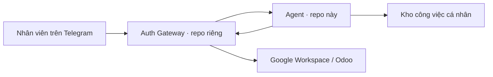

# AI Agent — Trợ lý công việc qua Telegram

Dự án giúp nhân viên xem lịch, email chưa đọc và công việc cá nhân từ một cuộc trò chuyện Telegram.

**Đây là repo Agent độc lập.** Bạn chỉ cần clone repo này để đọc code, chạy test và phát triển Agent. Không cần clone hoặc sửa repo Gateway.

Auth Gateway là dịch vụ bên ngoài, phụ trách đăng nhập, liên kết tài khoản và nhận/gửi tin Telegram. Khi chạy tích hợp, Agent sử dụng URL và API do người phụ trách Gateway cung cấp; hai repo không cần nằm cùng máy hoặc cùng thư mục.

- **Muốn xem dự án làm được gì:** đọc [Tổng quan dự án](docs/PROJECT_OVERVIEW.md).
- **Muốn bắt đầu làm code:** đọc [Hướng dẫn lập trình viên](docs/DEVELOPER_GUIDE.md).

## Hiện tại dùng được gì?

Trong chế độ tích hợp Gateway, Agent nhận các nhóm yêu cầu sau:

| Bạn gửi | Agent trả về |
|---|---|
| `/today` hoặc “Hôm nay tôi có gì?” | Lịch trong ngày, việc quá hạn/đến hạn hôm nay và thông tin Gmail chưa đọc |
| “Danh sách công việc” | Các công việc trong kho cá nhân, kèm trạng thái và hạn |
| “Tôi là ai?” | Thông tin tài khoản do Gateway cung cấp |
| “Kiểm tra kết nối” | Trạng thái liên kết và quyền truy cập dịch vụ |
| “Xin chào” | Hướng dẫn các chức năng đang hỗ trợ |

Các nhóm yêu cầu này được nhận diện bằng quy tắc trong code. Chúng chưa dùng LLM để trò chuyện tự do. Repo còn có các module AI, skill và LangGraph của luồng kết nối trực tiếp; đó là luồng riêng, không phải đường xử lý Gateway hiện tại.

Agent chưa mở thao tác tạo/sửa dữ liệu, gửi email hoặc gửi file qua luồng này. Khi thiếu kết nối hoặc lỗi nguồn dữ liệu, phản hồi sẽ nêu phần không lấy được.

## Agent và Gateway chia việc thế nào?



- **Gateway:** quản lý tài khoản và credential, gọi Google/Odoo, nhận và gửi Telegram.
- **Agent:** nhận yêu cầu từ Gateway, xác minh lại danh tính, lấy dữ liệu và tạo phản hồi. Công việc cá nhân được đọc theo chủ sở hữu.

## Bắt đầu đọc code

Cần Python 3.11. Từ thư mục vừa clone, chạy trên PowerShell:

```powershell
py -3.11 -m venv .venv
.\.venv\Scripts\python.exe -m pip install -r requirements.txt
.\.venv\Scripts\python.exe -m pytest tests/unit/test_task_formatter.py -q
```

Test dùng dữ liệu tạm, không cần repo Gateway hoặc tài khoản thật. Đây là kiểm tra mã, chưa phải chạy bot trên Telegram. Xem [hướng dẫn lập trình viên](docs/DEVELOPER_GUIDE.md) để chạy toàn bộ test và tìm đúng file cần sửa.

## Tài liệu

| Tài liệu | Đọc khi |
|---|---|
| [Tổng quan dự án](docs/PROJECT_OVERVIEW.md) | Cần hiểu giá trị, hiện trạng và giới hạn |
| [Hướng dẫn lập trình viên](docs/DEVELOPER_GUIDE.md) | Cần cài đặt, chạy test và sửa code Agent |
| [Tích hợp Gateway](docs/INTEGRATION_GATEWAY.md) | Cần cấu hình hai dịch vụ hoặc xem API |
| [Báo cáo lịch sử](docs/reports/) | Cần tra cứu quá trình phát triển trước đây |

Tài liệu lịch sử phản ánh thời điểm viết; tính năng hiện tại xem ở các tài liệu phía trên.
