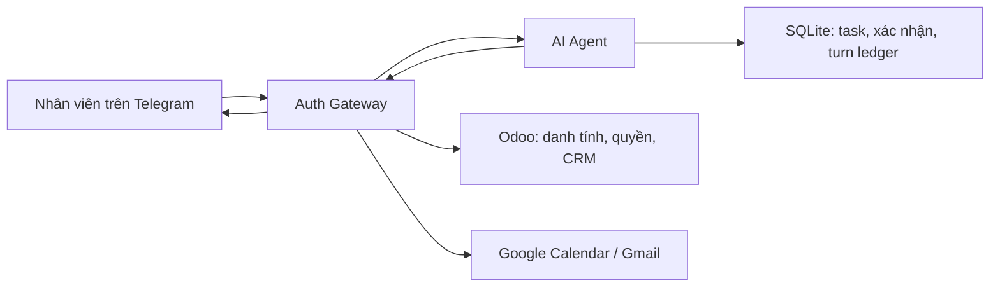

# AI Agent — Trợ lý công việc qua Telegram

Dịch vụ Python/FastAPI xử lý yêu cầu công việc từ Telegram qua Auth Gateway: tổng hợp điểm tin, đọc lịch/email/CRM, quản lý công việc cá nhân và chuẩn bị thao tác ghi để người dùng xác nhận.

README này hướng dẫn riêng dự án agent. Có thể cài dependencies và chạy unit test bằng repository này; không cần mã nguồn của dịch vụ bên ngoài. Khi chạy tích hợp, cần URL và secret của dịch vụ xác thực/API được cấp.

> **Trạng thái:** đang phát triển. Một số luồng ghi và xử lý retry còn lỗi đã biết; chưa nghiệm thu toàn bộ bằng tài khoản thật. Xem phần giới hạn cuối README.

## Kiến trúc



Agent chịu trách nhiệm phân tích yêu cầu, tạo phản hồi, quản lý task cá nhân, bản xem trước và xác nhận. Trong gateway mode, danh tính/quyền và dữ liệu Odoo/Google được lấy qua API bên ngoài; việc nhận/gửi Telegram do bên gọi endpoint turn đảm nhiệm.

Luồng chính là `gateway`. Repo còn có `direct` với connector, skill và LangGraph; đó là luồng riêng. Trong gateway mode, không chạy `start_bot.bat` hoặc poller Telegram của agent.

## Phạm vi tính năng hiện có

| Nhóm | Khả năng có trong mã |
|---|---|
| Hồ sơ | Tên, Odoo UID, tenant/database, chức vụ, phòng ban và quyền do gateway cung cấp |
| Kết nối | Trạng thái Odoo, Telegram, Google và OAuth scopes |
| Điểm tin | `/today`: lịch trong ngày, việc cần xử lý, Gmail chưa đọc |
| Công việc cá nhân | Xem, tạo, sửa tiêu đề, hoàn thành; phân tách theo owner key |
| Calendar | Xem lịch, tạo sự kiện mới, cập nhật lịch qua preview và xác nhận (hỗ trợ ETag / If-Match) |
| Gmail | Đọc thư chưa đọc, chuẩn bị và gửi email sau xác nhận |
| CRM | Tra cứu, tạo/sửa cơ hội qua preview và xác nhận (hỗ trợ expected_write_date); hiển thị chính xác mã lead |
| Ngôn ngữ tự nhiên | Quy tắc nhận diện kết hợp Gemini action parser khi có API key; hội thoại còn giới hạn |

Thao tác ghi đi qua preview và xác nhận có hạn 5 phút, gắn với người dùng, private chat và Telegram binding. Chưa mở xóa dữ liệu, gửi thư hàng loạt, HR/kế toán hoặc tệp đính kèm qua luồng này.

Chức vụ dùng cho ngữ cảnh/cá nhân hóa, không tự cấp quyền. Tài khoản Google có thể là Gmail cá nhân nếu gateway cho phép; lịch và thư thuộc tài khoản Google đã liên kết, quyền CRM vẫn thuộc Odoo.

## Cài đặt

Yêu cầu Python 3.11. Chạy từ thư mục chứa `requirements.txt` trên PowerShell:

```powershell
py -3.11 -m venv .venv
.\.venv\Scripts\python.exe -m pip install -r requirements.txt
.\.venv\Scripts\python.exe -m pytest tests/unit tests/integration/test_internal_turn.py -q
```

Nhóm test này dùng dữ liệu tạm và mock; không cần gateway, Telegram token, LLM key, PostgreSQL hoặc Redis thật. Các module ngoài nhóm test này có thể có yêu cầu riêng.

## Cấu hình gateway mode

```powershell
# Bỏ qua nếu đã có .env, tránh ghi đè cấu hình hiện tại.
Copy-Item .env.example .env
```

Thiết lập tối thiểu:

```dotenv
APP_ENV=development
APP_DEBUG=false
PORT=8000
INTEGRATION_MODE=gateway
GATEWAY_BASE_URL=http://localhost:8080
GATEWAY_TO_AGENT_SECRET=<secret-chieu-gateway-den-agent>
AGENT_TO_GATEWAY_SECRET=<secret-chieu-agent-den-gateway>
# Để trống nếu chỉ thử lệnh xác định, không dùng Gemini parser.
GEMINI_API_KEY=
```

Hai secret phải khác nhau, mỗi secret ít nhất 32 ký tự và khớp với gateway. Sinh secret bằng:

```powershell
.\.venv\Scripts\python.exe -c "import secrets; print(secrets.token_urlsafe(48)); print(secrets.token_urlsafe(48))"
```

Thay các giá trị mẫu trước khi dùng. Khi bật phân tích ngôn ngữ tự nhiên, đặt `GEMINI_API_KEY` và `DEFAULT_LLM_MODEL` phù hợp với môi trường được cấp. Parser gateway hiện dùng Gemini; chỉ điền `OPENAI_API_KEY` chưa thay thế được parser này.

Credential Odoo, bot token Telegram và OAuth Google của người dùng được cấu hình/quản lý tại gateway. Những biến tương ứng trong file mẫu agent chủ yếu phục vụ direct mode; không sao chép credential người dùng sang agent để khắc phục lỗi tích hợp.

Yêu cầu đối với dịch vụ bên ngoài: cung cấp identity contract v2, API dữ liệu/action và chuyển yêu cầu tới endpoint turn của agent. Thống nhất URL cùng hai secret với người vận hành dịch vụ đó; không cần cấu hình hoặc clone mã nguồn dịch vụ trong repository này.

`.env.example` không tự cập nhật `.env` đang dùng; code agent mặc định `direct` nếu không đặt mode.

## Khởi động

```powershell
.\.venv\Scripts\python.exe -m uvicorn app.main:app --host 127.0.0.1 --port 8000
```

- Healthcheck: [http://localhost:8000/api/v1/health](http://localhost:8000/api/v1/health).
- OpenAPI: [http://localhost:8000/docs](http://localhost:8000/docs), chỉ khi đặt `APP_DEBUG=true`.

Nhân viên đăng nhập và liên kết tài khoản tại portal gateway trước khi gửi yêu cầu tới bot. Agent tra identity qua gateway; người dùng không cần đăng nhập Odoo lần hai trong luồng này.

API khởi động thành công không chứng minh Odoo/Google đã kết nối. Healthcheck không thay thế kiểm tra quyền và dữ liệu thật.

## Ví dụ sử dụng

| Yêu cầu trên Telegram | Mục đích |
|---|---|
| `/today` | Điểm tin hôm nay |
| `Tôi là ai?` | Hồ sơ đã xác minh |
| `Kiểm tra kết nối` | Trạng thái các dịch vụ |
| `/task list` | Danh sách công việc cá nhân |
| `/task create Báo cáo tuần` | Preview tạo công việc |
| `/task done task_12345678` | Preview hoàn thành công việc |
| `/calendar list` | Lịch sắp tới |
| `/email list` | Gmail chưa đọc |
| `/crm search khách hàng` | Tra cứu lead |
| `/confirm <mã>` hoặc `/cancel <mã>` | Thực thi hoặc hủy yêu cầu đang chờ |

Ví dụ cú pháp đầy đủ để tạo preview, dùng dữ liệu thử nghiệm:

```text
/task create Báo cáo tuần | 2026-11-01T17:00:00+07:00 | high
/calendar create Họp nhóm | 2026-11-01T09:00:00+07:00 | 2026-11-01T10:00:00+07:00
/email send colleague@example.com | Tiêu đề thử nghiệm | Nội dung thử nghiệm
/crm create Cơ hội thử nghiệm | 0900000000 | customer@example.com | 1000000
```

ID và mã xác nhận phải lấy từ phản hồi thật. Kiểm tra preview trước khi xác nhận; không tự gửi lại thao tác ghi khi kết quả trước đó chưa xác định.

## API và đường xử lý

Gateway gọi `POST /internal/v1/telegram/turn` với `Authorization: Bearer <GATEWAY_TO_AGENT_SECRET>`. Agent trả `request_id` và danh sách chuỗi `messages`; gateway giao lên Telegram.

Agent dùng `AGENT_TO_GATEWAY_SECRET` để gọi identity, connections, Calendar/Gmail/CRM và API actions. Identity yêu cầu contract v2. HTTP 200 có thể chứa thông báo lỗi quyền/kết nối hoặc yêu cầu xác nhận; không phải bằng chứng nghiệp vụ thành công.

| Thành phần | Vị trí |
|---|---|
| Endpoint turn | `app/api/v1/internal.py` |
| Dispatcher và Gemini parser | `app/services/gateway_agent_dispatcher.py` |
| HTTP client gateway | `app/services/gateway_client.py` |
| Xác nhận và sổ turn | `app/services/confirmation_service.py`, `app/services/turn_ledger.py` |
| Task cá nhân | `app/providers/tasks/local.py` |
| Điểm tin | `app/services/morning_briefing_service.py` |

Thêm skill vào registry direct mode không tự mở skill đó qua gateway.

## Lưu trữ và Docker

Task và xác nhận nằm trong `data/tasks.db`; sổ turn nằm trong `data/turn_ledger.db`, tính từ thư mục chạy. Các module khác còn có dữ liệu runtime riêng. Không commit `.env`, `data/`, `.agent_data/`, token hoặc bản sao lưu.

Compose hiện gồm agent, PostgreSQL và Redis; agent nối thêm mạng ngoài `auth_gateway_net`. Mạng này phải tồn tại trước khi khởi động. Khi chạy độc lập, tạo mạng nếu chưa có:

```powershell
docker network create auth_gateway_net
docker compose up -d --build
docker compose logs -f ai-agent
```

Đặt `GATEWAY_BASE_URL` theo địa chỉ dịch vụ API bên ngoài mà container truy cập được. Nếu dịch vụ nằm trên mạng chung, dùng tên service/alias và cổng nội bộ được cung cấp. Không dùng `localhost` để gọi container khác.

Compose đã được cấu hình gắn volume bền vững `agent_sqlite_data` cho thư mục `/app/data` của agent (lưu trữ `tasks.db`, `turn_ledger.db`, `reminders.db`...) và kết nối mạng chung `auth_gateway_net`. Dữ liệu nghiệp vụ và trạng thái idempotency được bảo toàn qua các lần tạo lại container.

## Kiểm thử và kết quả xác minh

```powershell
# Chạy toàn bộ test suite của Agent (221 passed, 1 skipped):
.\.venv\Scripts\python.exe -m pytest -v
```

Toàn bộ **221 test** tự động đều đã chạy thành công (bao gồm unit test cho identity context v2, task/calendar/crm dispatching, turn cache verification, atomic confirmations và idempotency).

### Trạng thái các lỗi chặn nghiệp vụ đã giải quyết

1. **API đọc chi tiết Calendar/CRM:** Gateway đã sửa đúng chữ ký giải mã credential và kiểm tra quyền, cho phép Agent lấy snapshot và ETag/write_date thật để thực hiện preview/update.
2. **Xác minh trước khi đọc cache turn:** Agent resolve identity từ Gateway trước khi truy xuất cache hoặc nhận turn. Đối chiếu `telegram_binding_id`, từ chối replay các bản ghi cũ thiếu binding/hash, và trả HTTP 503 khi gặp sự cố mạng Gateway tạm thời.
3. **Thống nhất kết quả CRM:** Formatter đọc trực tiếp `result.id` (và fallback `result.lead.id`), hiển thị chính xác mã cơ hội và chỉ hiển thị doanh thu khi có dữ liệu thực tế.
4. **Chuẩn hóa trạng thái chưa rõ kết quả:** `UNKNOWN_RESULT`, timeout và lỗi mạng được lưu trạng thái `unknown_result` mà không bị ghi đè thành thất bại; giữ nguyên operation ID cố định từ preview và chặn thực thi nếu thiếu ID để ngăn chặn duplicate execution.

## Giới hạn còn lại và lưu ý vận hành

- Phân tích yêu cầu hội thoại tự do phức tạp phụ thuộc vào mô hình LLM (Gemini API). Khi không có API key, các lệnh slash command xác định (`/today`, `/task`, `/calendar`, `/email`, `/crm`, `/confirm`) vẫn hoạt động bình thường.
- Không tự ý thực thi lại hoặc hướng dẫn người dùng gửi lại ngay các thao tác đang có trạng thái `unknown_result` hoặc `in_progress` để tránh phát sinh tác vụ trùng lặp trên các dịch vụ bên ngoài.

## Tài liệu bổ sung

- [Tổng quan dự án](docs/PROJECT_OVERVIEW.md).
- [Hướng dẫn lập trình viên](docs/DEVELOPER_GUIDE.md).
- [Contract tích hợp gateway](docs/INTEGRATION_GATEWAY.md).
- [Báo cáo lịch sử](docs/reports/).
